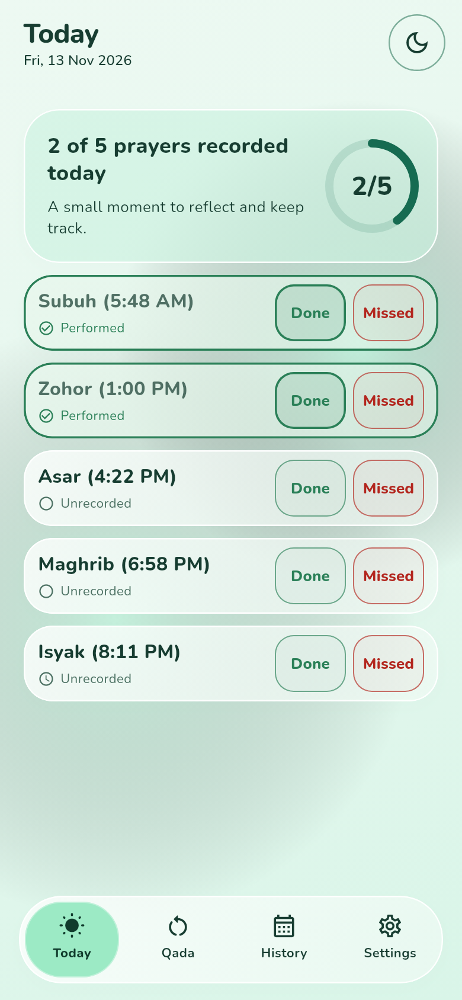
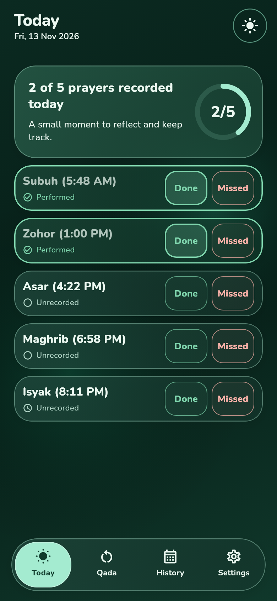
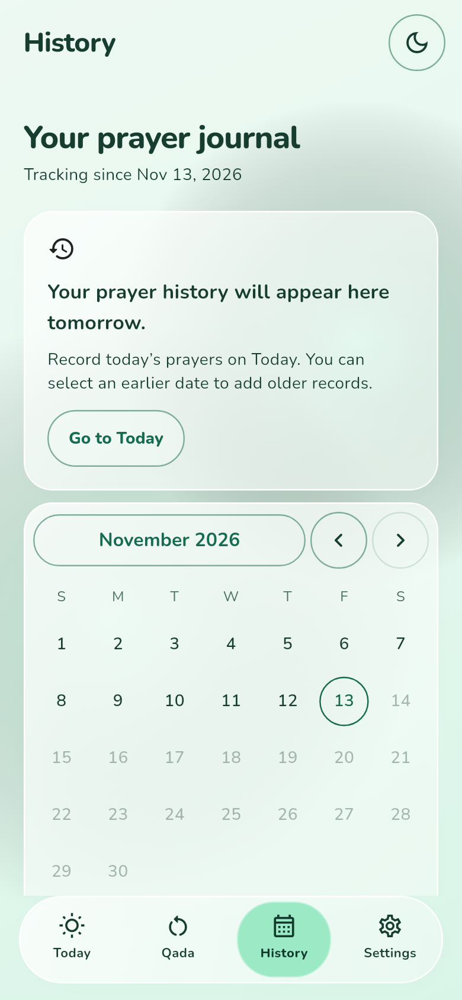

# Qada Tracker

A personal Android prayer journal built with **Flutter, Dart, Riverpod, SQLite/Drift, and Kotlin**. It tracks daily prayers, keeps editable history, and records dated qada (replacement-prayer) completions.

This repository is prepared as a software engineering portfolio for code review and local evaluation. The app is a personal project, with no Play Store release, accounts, backend, advertising, analytics, or cloud sync. Android is the validated target; iOS is not implemented or validated.

## Preview

<table>
<tr><td>Today · light</td><td>Today · dark</td><td>History</td></tr>
<tr>
<td></td>
<td></td>
<td></td>
</tr>
</table>

These are Flutter-rendered previews generated by widget tests with synthetic records and mocked prayer-time responses, not screenshots of personal records or physical-device validation.

## Features

- **Today:** compact Done/Missed controls for Subuh, Zohor, Asar, Maghrib, and Isyak, with 12-hour prayer times and start-time validation.
- **History:** editable daily records, calendar completion indicators, and badges for confirmed misses awaiting qada. Unrecorded prayers never silently become debt.
- **Qada and Progress:** per-prayer balances, dated replacement entries, links to the exact historical prayer, and weekly/monthly statistics.
- **Android integration:** interactive home-screen widget, configurable local prayer-time alerts and daily check-in reminders, and recovery after reboot or clock changes.
- **Preferences and privacy:** English/Malay, light/dark themes, a first-launch walkthrough, optional manually confirmed menstrual-period exemptions/tracking pauses, and manual JSON backup/restore.

## Engineering highlights

| Area | Implementation and review starting point |
| --- | --- |
| Domain rules | [model.dart](lib/model.dart): three recording states plus explicit exemptions; nonnegative qada balances and dated completions |
| State and concurrency | [controller.dart](lib/controller.dart), [database.dart](lib/database.dart): serialized mutations, SQLite transactions, and compare-and-swap retries across Flutter and native widget writes |
| Time boundaries | [prayer_recording_policy.dart](lib/prayer_recording_policy.dart): matching cached timetable, exact start instants, and atomic rejection of invalid changes |
| External integration | [prayer_times_api.dart](lib/prayer_times_api.dart): Malaysian WaktuSolat/JAKIM timetables, cache validation, location selection, and offline fallback |
| Native Android | [Kotlin implementation](android/app/src/main/kotlin/com/personal/qada_tracker): RemoteViews widgets, alarms, notifications, and background calendar refresh |
| Backup integrity | [backup.dart](lib/backup.dart) and the journal model: complete version validation and confirmed atomic replacement |
| Verification | [Flutter tests](test), [Android JVM tests](android/app/src/test/kotlin/com/personal/qada_tracker), and [validation records](VALIDATION.md) |

The domain distinguishes **unrecorded**, **performed**, and **missed**. Explicit exemptions are stored separately. Qada completion keeps the original missed record and links its replacement to that date/prayer. Older starting balances and replacements remain compatible with existing journals.

## Build and run

Pinned baseline: **Flutter 3.38.5 / Dart 3.10.4**, JDK 17, Android SDK 36, and build tools 35.0.0. Requires an Android device/emulator (minimum API 24) to run the app. No API key is required.

With Flutter and the Android toolchain installed:

```bash
git clone https://github.com/zulhisyamsofi/qada-tracker.git
cd qada-tracker
flutter pub get
flutter run -d <android-device-id>
```

For the reproducible Linux x86-64 cloud setup:

```bash
./scripts/setup.sh
source scripts/env.sh
./scripts/validate.sh
```

The setup script defaults to `/workspace/toolchains`; set `QADA_TOOLS` to a writable directory on your machine before setup and sourcing `env.sh`. Setup and first-time native tests need internet access. See the [development guide](USER_GUIDE.md#development) for dependencies and platform details.

## Verification

The v1.35.0 baseline passed **155 Flutter tests**, **63 Android JVM tests**, formatting, static analysis, and debug/universal/per-architecture release APK builds. Regression coverage includes restarts, midnight rollover, multi-day gaps, qada corrections, atomic backup restore, concurrent widget writes, notification scheduling policies, and narrow-screen layout stability.

```bash
dart format --output=none --set-exit-if-changed lib test
flutter analyze
flutter test
# Android JVM tests (from android/)
./gradlew :app:testDebugUnitTest
```

The Android suite uses Robolectric. Physical-device notification delivery, launcher behavior, and OEM battery restrictions are not proven by these tests. See [VALIDATION.md](VALIDATION.md) for evidence and limitations.

## Releases and data

[Release history](RELEASES.md) · [Changelog](CHANGELOG.md) · [User guide](USER_GUIDE.md) · [Privacy](PRIVACY.md) · [Security](SECURITY.md) · [Publication review](docs/PUBLICATION_REVIEW.md)

The repository is useful for source review without installing an APK. Existing APKs are personal evaluation builds signed with a development certificate, not production-distribution builds. Never reuse a personal-installation signer for an unrelated app. Making the repository public does not publish the app to Google Play.

Prayer records remain on the device. Prayer-time downloads send the selected place coordinates to the external provider; optional device location is rounded before storage/use. JSON backups are unencrypted and can contain sensitive records. See [PRIVACY.md](PRIVACY.md).

## Ownership and acknowledgements

Copyright © 2026 Hisyam Sofi. **All rights reserved; no open-source license is granted for the original project code.** Public visibility supports inspection through GitHub; it does not grant general reuse or redistribution rights. See [COPYRIGHT.md](COPYRIGHT.md).

Nunito is bundled under the [SIL Open Font License](assets/fonts/OFL.txt). Flutter, packages, and Android dependencies retain their respective licenses and notices. Prayer-time data is obtained through [WaktuSolat](https://api.waktusolat.app), which serves JAKIM timetables; this project is not affiliated with either provider. The earlier generated visual concept is identified as a reference in the [design notes](docs/design/glass-ui.md).
