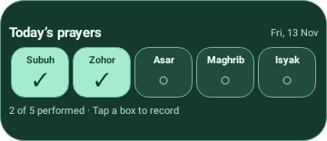

# Home-screen prayer widget — v1.4, with v1.5 time validation




These are actual RemoteViews rendered with Robolectric's Android native graphics, using a sample day with two performed prayers. They are previews of the native widget, not screenshots from a phone launcher.

## Use

1. Install v1.4 as an update and open Qada Tracker once.
2. Choose **Settings → Home-screen widget** and accept the launcher's Add prompt. If pinning is unsupported, the app shows manual instructions: touch and hold an empty area of the home screen, open Widgets, and select **Qada Tracker → Today’s prayers**.
3. Tap one of the five boxed prayer buttons after its saved prayer time starts. Early taps explain that it has not started; missing or mismatched saved times ask you to refresh in the app first. The mark is saved before a check is displayed. It works with Flutter closed and does not open the app for each tap.
4. Tap the header or footer to open Today. Unticking, missed-prayer confirmation, history corrections, and qada replacements remain inside the app.

The widget is approximately 4 × 2 launcher cells, with a 280 × 130 dp minimum content size. Launchers determine their own grid sizing. Performed boxes have a check and mint fill; unrecorded boxes have a circle; confirmed misses have an amber fill and exclamation mark. Accessible descriptions include the full prayer name, status, and action. It follows the saved light/dark setting, or the system theme at refresh when Follow system is selected.

## Data and lifecycle

- `PrayerHomeWidget` is a native `AppWidgetProvider`; the five actions use distinct immutable, explicit broadcast PendingIntents, scoped by widget ID, local date, and prayer. Only currently placed widget IDs are accepted. The receiver is not exported.
- `PrayerWidgetStore` opens the existing `filesDir/journal.sqlite`; it never initializes a missing journal or replaces an unreadable/unsupported one. A SQLite write transaction reads the latest document, resolves the local day after taking the write lock, applies the single performed status, and commits. Other records, starting balances, replacements, settings, and downloaded times are preserved.
- The matching dated timetable and selected source are checked inside the journal’s write transaction. Before-start actions and unavailable/malformed/wrong-place/wrong-date caches leave the journal unchanged. The widget never starts a network request for a tap.
- Repeated performed taps are idempotent. A confirmed miss may be corrected only if removing it leaves its qada balance nonnegative. No replacement entry is created or erased. Failed writes leave the old document unchanged and show a retry message.
- Flutter mutations now rebase on the disk journal and compare-and-swap the complete document, retrying conflicts. This protects widget changes made after the UI snapshot was loaded. A short SQLite busy timeout accommodates native writes. Restore intentionally replaces the complete validated journal and then refreshes widgets.
- An internal broadcast reloads an active Flutter app. App resume also reloads disk through the controller's mutation queue. Committed app writes/restore/theme changes refresh every widget. Native widget taps update all instances and cancel a displayed daily check-in once a prayer is recorded.
- Widget marks are included in normal JSON backups because they are ordinary journal records. No new schema, backup version, service, account, network request, or permission is introduced.
- A single next-local-midnight alarm covers all instances; existing exact-alarm access is respected, with an inexact fallback. Periodic system widget updates run at a requested 30-minute interval. Boot, app update, and clock/timezone broadcasts also refresh and reschedule. Removing the final widget cancels its rollover alarm.
- Android may delay alarms/launcher refreshes, especially without exact-alarm access or during battery restrictions/force-stop. The displayed date makes the snapshot explicit. An old-date tap only refreshes and requests a second tap; it does not write either day. Missed days remain unrecorded until reviewed in the app.

## Validation

The widget regression tests cover all five saved marks with Flutter absent, duplicate taps, persistence through new SQLite connections, preservation of other journal fields, confirmed-miss correction with and without a qada conflict, transaction failure rollback, absent/unsupported data, invalid inputs, stale-date actions, multi-day gaps, local-midnight/DST scheduling, all-instance refresh and restore, unique action identities, both theme renders, minimum-size labels, and a real PendingIntent click through the provider that saves data, refreshes both instances, and dismisses a check-in notification.

Flutter tests cover rebasing a stale UI, a simulated compare-and-swap collision, failed-write UI behavior, platform events, resume reload, launcher synchronization, unavailable launcher/plugin behavior, and Settings fallback instructions. The full earlier prayer/qada/history/backup/reminder/API/theme suite is retained.

Native tests use Robolectric 4.16.1 on Android API 35 with native graphics and SQLite. Run:

```bash
source scripts/env.sh
flutter test test/home_widget_test.dart
(cd android && QADA_CAPTURE_WIDGET=1 ./gradlew :app:testDebugUnitTest --console=plain)
```

Captures go to ignored `build/widget-qa`. The permanent light/dark previews above are retained for review. This simulated Android environment does not prove actual launcher placement, process eviction, Doze delivery, OEM battery behavior, or drag/resize interactions on a phone. No connected device or usable accelerated emulator is available in this cloud instance.

## Phone check

Add two instances, mark prayers from either one with the app closed, and reopen Today/History/Progress to confirm the same records. Correct a prayer in the app and confirm both widgets update. Export a backup and check the widget marks are present; restore only a disposable test journal if testing replacement. Check rollover over midnight, a clock/timezone change, reboot, and resize on your actual launcher. For a qada conflict, use disposable data rather than changing real prayer records.
