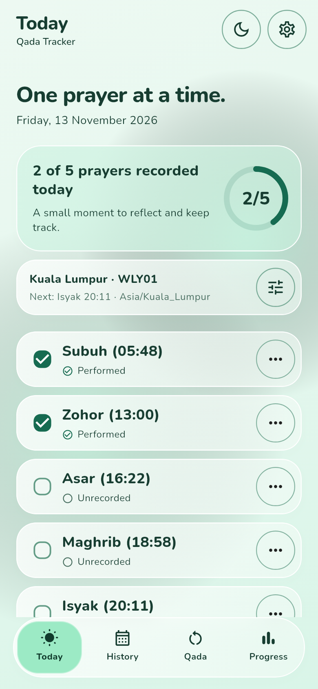
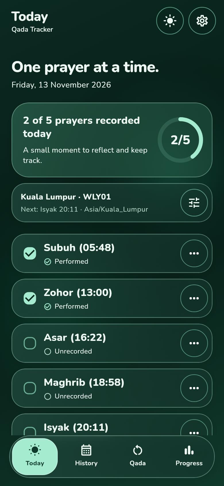

# Integrated prayer times — v1.5

These are Flutter-rendered previews with sample records, not physical-phone screenshots.

Today now shows the five prayer labels with parenthesized times. The compact location card shows the saved place, resolved zone, next prayer, and timetable timezone. Its sliders button opens the Malaysia dropdown, optional device location, refresh, source information, and prayer-notification controls. The standalone Times tab is removed; prayer alerts open Today. Pull down on Today to refresh. Existing glass styling, theme controls, history, review, qada, and progress remain.

## Recording rules

- New performed marks for today require the selected place's complete saved timetable for that journal date. Before the prayer starts, checkboxes/menu actions show a floating error message, including its start time and timezone, and leave the record unchanged. The control stays tappable to explain the restriction. At the exact start instant it is allowed without reopening the app.
- The home-screen widget enforces the same restriction with a short Android toast. It rechecks at the actual write time rather than trusting the launcher's older view.
- A valid matching saved timetable works offline, even if refreshing the download fails. Missing, incomplete, malformed, wrong-place, or wrong-date data cannot grant permission to mark a prayer performed. Refresh or correct the place first. The app shows `--:--` until a matching time is available.
- Existing performed records stay saved, including records from earlier versions. Unticking, confirmed misses, past-day corrections, and qada replacements remain available; unrecorded never silently becomes missed. Explicit backup restores preserve confirmed records and still validate the full journal and qada balances.
- Journal dates remain phone-local calendar dates. Each displayed time is selected by that exact date key, not the timetable timezone's possibly different current date. Start instants are compared with the clock in UTC-equivalent time, not by comparing displayed hours.

## Persistence and concurrent edits

`PrayerRecordingPolicy` checks new performed transitions in the serialized controller mutation path, covering today's History and generic app mutations as well as checkboxes/menus. SQLite reads the journal and calendar snapshot together; the guarded UPDATE compares both documents and retries/revalidates if either changed. This prevents concurrent widget edits or a background/foreground calendar refresh from bypassing the check. Restore intentionally replaces the validated snapshot rather than treating its confirmations as new check-ins.

Native `PrayerWidgetStore` reads the journal and parsed timetable under the same SQLite write lock, verifies source/date and exact start instant, and only then applies the existing status/balance rules. Rejection or a write error never partially changes a journal. Existing records/settings/calendar backups need no migration or format change.

## Verification

Tests cover before/start/after boundaries (including the native millisecond boundary), complete and missing calendars, source/date changes, malformed native caches, phone-date/timetable-date differences, settings and historical corrections, preserved restored records, atomic multi-prayer rejection, queued changes, and concurrent calendar replacement. UI tests exercise early checkbox/menu taps, an allowed tap at the boundary, location denial and place changes, offline notification controls, and alert navigation to Today. Light/dark prayer settings and all four tabs render without exceptions, with a separate narrow-screen/high-contrast/large-text check.

The full Flutter, native policy/widget, analysis, and APK checks are recorded in [VALIDATION.md](../VALIDATION.md). Native widget tests use Robolectric; real phone placement, notification delivery, and device-clock/Doze behavior remain unverified in this cloud environment.

On a phone, verify the selected locality/zone, try a future prayer from both Today and the widget, then try it again after its real start. Check a saved day's times offline and confirm that changing place while offline requests a refresh rather than using the previous location. Preserve your real prayer records while checking corrections.
